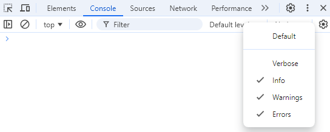

The debug machinery itself, `getDebugger`, the `DebugController` and how namespaces are enabled, lives in `@mnaoumov/typescript-lib` and is described in its [Debugging](https://mnaoumov.dev/typescript-lib/guides/debugging/) guide. This page covers what a plugin built on this library adds to it.

## Showing debug messages in Obsidian

By default, console debug messages are not shown. To enable them you have to enable `Verbose` mode in the console settings.



When you enable `Verbose` mode, you will see debug messages in the console sent via `console.debug()` calls.

By default, none of the debug messages are shown. You have to enable the debug namespace explicitly.

To see debug messages for your plugin `alpha-bravo`, you have to enable them by running the corresponding command in the console:

```javascript
window.DEBUG.enable('alpha-bravo'); // show all debug messages from the `alpha-bravo` plugin
window.DEBUG.enable('alpha-bravo:obsidian-lib:*'); // show all debug messages from this library within the `alpha-bravo` plugin
window.DEBUG.enable('alpha-bravo:*'); // show all debug messages from the `alpha-bravo` plugin and its submodules
window.DEBUG.enable('*:obsidian-lib:*'); // show all debug messages for this library within any plugin
window.DEBUG.enable('*'); // show all debug messages
```

The library's own messages use the namespace `obsidian-lib`, such as `alpha-bravo:obsidian-lib:PluginApi`. So do the messages of the generic helpers that come from `@mnaoumov/typescript-lib`, such as the async and error helpers, because a plugin context sets that namespace for them. So `alpha-bravo:obsidian-lib:*` shows every library message in a plugin.

See full documentation of [`window.DEBUG`](https://github.com/mnaoumov/typescript-lib/blob/main/src/debug-controller.ts).

> [!NOTE]
>
> You will see `CustomStackTraceError` in the debug messages. They are not actual errors. It's just a workaround to make stack trace links clickable.
>
> Do not add `window.DEBUG` calls in your plugin code. This is designed to be run only from the console.

To write debug messages from your plugin, call `consoleDebug()` on the plugin's `consoleDebugComponent`. `PluginBase` creates that component for you and logs through it under your plugin's id:

```typescript
import { PluginBase } from '@mnaoumov/obsidian-lib/plugin/plugin';

export class AlphaBravoPlugin extends PluginBase {
  protected override async onloadImpl(): Promise<void> {
    await super.onloadImpl();
    this.consoleDebugComponent.consoleDebug('alpha', 'bravo', 'charlie');
  }
}
```

The member is `protected`, so call it from inside your plugin class.

## Advanced Debug Mode

You can use [Advanced Debug Mode](https://community.obsidian.md/plugins/advanced-debug-mode) plugin to configure debug namespaces via Settings UI.

## Cancelling a runaway operation

A vault-wide operation that turns out to be slower, or wronger, than expected can be aborted from the console:

```javascript
globalThis[Symbol.for('@mnaoumov/typescript-lib/state')].values.sharedAbortController.value.abort();
```

This aborts the app-wide shared abort signal, so every operation currently observing it stops. The controller is the one [`getSharedAbortController()`](https://mnaoumov.dev/typescript-lib/api/abort-controller/getSharedAbortController/) returns. Every plugin built on this library shares it, so the call cancels whichever operation is running.

The signal is replaced immediately after the abort, which means the next operation starts with a fresh one and the call above works as many times as you press it. A plain `AbortController` would stay aborted forever after the first call.

For this to cancel anything, the operation has to be observing that signal in the first place. From plugin code, pass it wherever an `abortSignal` is accepted — most usefully to `loop()`:

<!-- snippet-check: context declare function processFile(file: import('obsidian').TFile): Promise<void>; -->

```typescript
import { getSharedAbortSignal } from '@mnaoumov/typescript-lib/abort-controller';
import { loop } from '@mnaoumov/obsidian-lib/loop';
import { PluginBase } from '@mnaoumov/obsidian-lib/plugin/plugin';

export class AlphaBravoPlugin extends PluginBase {
  private async processAllNotes(): Promise<void> {
    await loop({
      abortSignal: getSharedAbortSignal(),
      buildNoticeMessage: ({ item, iterationString }) => `Processing ${iterationString} - ${item.path}`,
      items: this.app.vault.getMarkdownFiles(),
      pluginNoticeComponent: this.pluginNoticeComponent,
      processItem: async (file) => {
        await processFile(file);
      }
    });
  }
}
```

Call `getSharedAbortSignal()` at the start of each operation rather than caching it, or the operation after the first abort starts already aborted.
