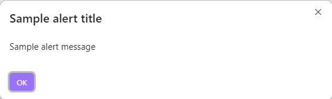
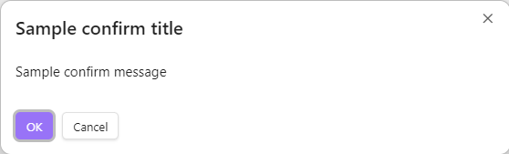
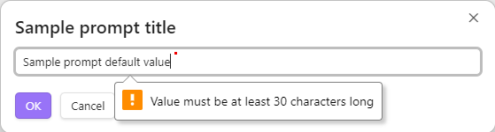
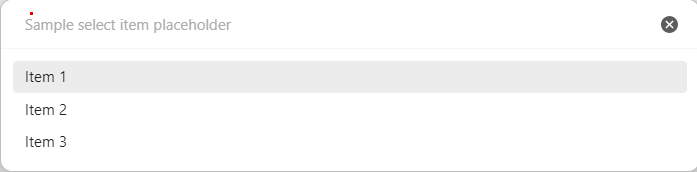

`@mnaoumov/obsidian-lib` provides some modals that you can use in your plugin.

In order for modals to look properly, their styles have to be initialized. See [Styling](/obsidian-lib/guides/styling/) for more details.

## Alert

```ts
import { alert } from '@mnaoumov/obsidian-lib/modals/alert';

await alert({
  app,
  message: 'Sample alert message',
  title: 'Sample alert title'
});
```



## Confirm

```ts
import { confirm } from '@mnaoumov/obsidian-lib/modals/confirm';

await confirm({
  app,
  message: 'Sample confirm message',
  title: 'Sample confirm title'
});
```



## Prompt

```ts
import { prompt } from '@mnaoumov/obsidian-lib/modals/prompt';
import type { MaybeReturn } from '@mnaoumov/typescript-lib/type';

await prompt({
  app,
  defaultValue: 'Sample prompt default value',
  title: 'Sample prompt title',
  valueValidator(value: string): MaybeReturn<string> {
    if (value.length < 30) {
      return 'Value must be at least 30 characters long';
    }
  }
});
```



## Select Item

```ts
import { selectItem } from '@mnaoumov/obsidian-lib/modals/select-item';

await selectItem({
  app,
  items: ['Item 1', 'Item 2', 'Item 3'],
  itemTextFunction(item: string): string {
    return item;
  },
  placeholder: 'Sample select item placeholder'
});
```



## Select Option

Unlike [Select Item](#select-item) (a fuzzy-search picker over an arbitrary list), `selectOption` renders one button per option — useful for a small, fixed set of mutually-exclusive choices where each choice has its own label and resolved value. One option can be marked as the call-to-action (primary) button. It resolves with the chosen value, or `null` if the modal is dismissed without a choice.

```ts
import { selectOption } from '@mnaoumov/obsidian-lib/modals/select-option';

const chosen = await selectOption({
  app,
  message: 'Sample select option message',
  options: [
    { isCta: true, text: 'Yes', value: 'yes' },
    { text: 'No', value: 'no' },
    { text: 'Cancel', value: null }
  ],
  title: 'Sample select option title'
});
```

## Code Block Builder

<!-- cspell:words altarok -->

`showCodeBlockBuilder` builds a plugin's code block from a declarative list of fields: toggles, color pickers, text with an optional validation pattern, sliders, single and multiple-choice dropdowns, cascading dropdowns, vault folders, and collapsible groups of fields. A field whose value differs from its default writes one `key: value` line into the block, and a required field always does. The modal shows the block live, lets your plugin draw a preview of it, and offers Copy and Insert into the note. It resolves with the inserted block, or `null` if the user closed it without inserting.

```ts
import { showCodeBlockBuilder } from '@mnaoumov/obsidian-lib/modals/code-block-builder';

const codeBlock = await showCodeBlockBuilder({
  app,
  fields: [
    { defaultValue: 'chart', isRequired: true, key: 'type', name: 'Type', type: 'text' },
    { defaultValue: false, key: 'grid', name: 'Show grid', type: 'boolean' },
    {
      fields: [
        { defaultValue: 400, key: 'width', max: 1000, min: 100, name: 'Width', step: 50, type: 'slider' },
        { defaultValue: 'blue', key: 'palette', name: 'Palette', options: ['blue', 'green'], type: 'dropdown' }
      ],
      name: 'Layout',
      type: 'group'
    }
  ],
  language: 'my-chart',
  onUpdatePreview({ codeBlock, previewEl }): void {
    previewEl.setText(codeBlock);
  }
});
```

The fence is one backtick longer than the longest backtick run in the values, so a value holding a fence never ends the block early. The modal was adapted, with credit, from the code block creator in [altarok's `obsidian-dev-utils`](https://github.com/altarok/obsidian-dev-utils).
