`@mnaoumov/obsidian-lib` provides some setting components that you can use in your plugin.

In order for components to look properly, their styles has to be initialized. See [Styling](/obsidian-lib/guides/styling/) for more details.

## CheckboxComponent

```ts
import { CheckboxComponent } from '@mnaoumov/obsidian-lib/setting-components/checkbox-component';

const checkbox = new CheckboxComponent(containerEl);
checkbox.setValue(false);

// or

import { SettingEx } from '@mnaoumov/obsidian-lib/setting-ex';

new SettingEx(containerEl)
  .addCheckbox((checkbox) => {
    checkbox.setValue(false);
  });
```


## CodeHighlighterComponent

```ts
import { CodeHighlighterComponent } from '@mnaoumov/obsidian-lib/setting-components/code-highlighter-component';

const codeHighlighter = new CodeHighlighterComponent(containerEl);
codeHighlighter
  .setLanguage('javascript')
  .setValue(`function alpha() {
  console.log('bravo');
}`);

// or

import { SettingEx } from '@mnaoumov/obsidian-lib/setting-ex';

new SettingEx(containerEl)
  .addCodeHighlighter((codeHighlighter) => {
    codeHighlighter
      .setLanguage('javascript')
      .setValue(`function alpha() {
  console.log('bravo');
}`);
  });
```

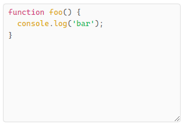

## DateComponent

```ts
import { DateComponent } from '@mnaoumov/obsidian-lib/setting-components/date-component';

const date = new DateComponent(containerEl);
date.setValue(new Date());

// or

import { SettingEx } from '@mnaoumov/obsidian-lib/setting-ex';

new SettingEx(containerEl)
  .addDate((date) => {
    date.setValue(new Date());
  });
```

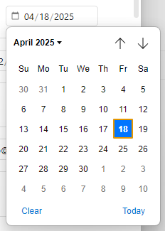

## DateTimeComponent

```ts
import { DateTimeComponent } from '@mnaoumov/obsidian-lib/setting-components/date-time-component';

const dateTime = new DateTimeComponent(containerEl);
dateTime.setValue(new Date());

// or

import { SettingEx } from '@mnaoumov/obsidian-lib/setting-ex';

new SettingEx(containerEl)
  .addDateTime((dateTime) => {
    dateTime.setValue(new Date());
  });
```

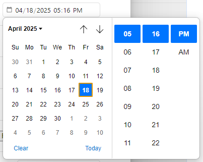

## EmailComponent

```ts
import { EmailComponent } from '@mnaoumov/obsidian-lib/setting-components/email-component';

const email = new EmailComponent(containerEl);
email.setValue('alpha@bravo.com');

// or

import { SettingEx } from '@mnaoumov/obsidian-lib/setting-ex';

new SettingEx(containerEl)
  .addEmail((email) => {
    email.setValue('alpha@bravo.com');
  });
```

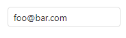

## FileComponent

```ts
import { FileComponent } from '@mnaoumov/obsidian-lib/setting-components/file-component';

const file = new FileComponent(containerEl);
file.onChange((value) => console.log(value));

// or

import { SettingEx } from '@mnaoumov/obsidian-lib/setting-ex';

new SettingEx(containerEl)
  .addFile((file) => {
    file.onChange((value) => console.log(value));
  });
```

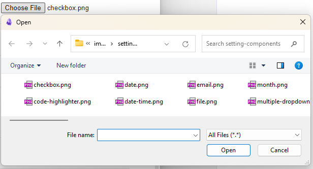

## FolderListComponent

A [`ListComponent`](#listcomponent) of vault folder paths. The new-item row suggests the vault's folders, and a typed path is normalized with Obsidian's `normalizePath`, so the root reads as `/`. A path need not exist yet.

```ts
import { SettingEx } from '@mnaoumov/obsidian-lib/setting-ex';

new SettingEx(containerEl)
  .addFolderList(app, (folderList) => {
    folderList.setValue(['Daily', 'Projects/Archive']);
    folderList.onChange((folders) => console.log(folders));
  });
```

## HotkeyComponent

A hotkey recorder: click the button, then press the key combination. Escape cancels the recording, and the clear button sets the value to `null`. The value is a `Hotkey`, the shape Obsidian stores in `hotkeys.json`, so it can be handed straight to `Scope.register`.

```ts
import { HotkeyComponent } from '@mnaoumov/obsidian-lib/setting-components/hotkey-component';

const hotkey = new HotkeyComponent(containerEl);
hotkey.setValue({ key: 'P', modifiers: ['Mod', 'Shift'] });
hotkey.onChange((value) => console.log(value));

// or

import { SettingEx } from '@mnaoumov/obsidian-lib/setting-ex';

new SettingEx(containerEl)
  .addHotkey((hotkey) => {
    hotkey.setValue({ key: 'P', modifiers: ['Mod', 'Shift'] });
  });
```

The same display string and key reading are available on their own, for a hotkey shown or captured anywhere else:

<!-- snippet-check: context declare const keyboardEvent: KeyboardEvent; -->
```ts
import {
  formatHotkey,
  getHotkeyFromKeyboardEvent
} from '@mnaoumov/obsidian-lib/hotkey';

formatHotkey({ hotkey: { key: 'P', modifiers: ['Mod', 'Shift'] } }); // 'Ctrl + Shift + P', or '⌘⇧P' on macOS
const pressed = getHotkeyFromKeyboardEvent({ event: keyboardEvent }); // null when only a modifier key is down
```

## ListComponent

A reorderable list of strings: each item has move-up, move-down and remove buttons, and a row below the list adds an item, on its button or on Enter. Text is trimmed, and an empty or duplicate item is not added. `newItemInputEl` is a plain `<input>`, so any `AbstractInputSuggest` can be attached to it; a subclass shapes items by overriding `normalizeItem` and `formatItem`, as `FolderListComponent` and `TagListComponent` do.

```ts
import { ListComponent } from '@mnaoumov/obsidian-lib/setting-components/list-component';

const list = new ListComponent(containerEl);
list.setPlaceholder('Add a word').setValue(['alpha', 'beta']);
list.onChange((items) => console.log(items));

// or

import { SettingEx } from '@mnaoumov/obsidian-lib/setting-ex';

new SettingEx(containerEl)
  .addList((list) => {
    list.setValue(['alpha', 'beta']);
  });
```

## MonthComponent

```ts
import { MonthComponent } from '@mnaoumov/obsidian-lib/setting-components/month-component';

const month = new MonthComponent(containerEl);
month.setValue({
  month: 4,
  year: 2025
});

// or

import { SettingEx } from '@mnaoumov/obsidian-lib/setting-ex';

new SettingEx(containerEl)
  .addMonth((month) => {
    month.setValue({
      month: 4,
      year: 2025
    });
  });
```

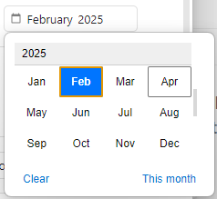

## MultipleDropdownComponent

```ts
import { MultipleDropdownComponent } from '@mnaoumov/obsidian-lib/setting-components/multiple-dropdown-component';

const multipleDropdown = new MultipleDropdownComponent(containerEl);
multipleDropdown.addOptions({
  Value1: 'Display 1',
  Value2: 'Display 2',
  Value3: 'Display 3',
  Value4: 'Display 4',
  Value5: 'Display 5'
});
multipleDropdown.setValue(['Value2', 'Value3']);

// or

import { SettingEx } from '@mnaoumov/obsidian-lib/setting-ex';

new SettingEx(containerEl)
  .addMultipleDropdown((multipleDropdown) => {
    multipleDropdown.addOptions({
      Value1: 'Display 1',
      Value2: 'Display 2',
      Value3: 'Display 3',
      Value4: 'Display 4',
      Value5: 'Display 5'
    });
    multipleDropdown.setValue(['Value2', 'Value3']);
  });
```

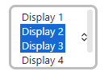

## MultipleEmailComponent

```ts
import { MultipleEmailComponent } from '@mnaoumov/obsidian-lib/setting-components/multiple-email-component';

const multipleEmail = new MultipleEmailComponent(containerEl);
multipleEmail.setValue(['alpha@bravo.com', 'charlie@delta.com']);

// or

import { SettingEx } from '@mnaoumov/obsidian-lib/setting-ex';

new SettingEx(containerEl)
  .addMultipleEmail((multipleEmail) => {
    multipleEmail.setValue(['alpha@bravo.com', 'charlie@delta.com']);
  });
```

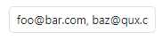

## MultipleFileComponent

```ts
import { MultipleFileComponent } from '@mnaoumov/obsidian-lib/setting-components/multiple-file-component';

const multipleFile = new MultipleFileComponent(containerEl);
multipleFile.onChange((value) => console.log(value));

// or

import { SettingEx } from '@mnaoumov/obsidian-lib/setting-ex';

new SettingEx(containerEl)
  .addMultipleFile((multipleFile) => {
    multipleFile.onChange((value) => console.log(value));
  });
```

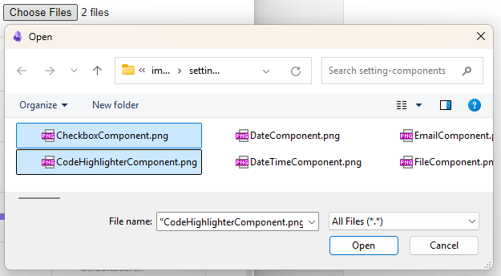

## MultipleTextComponent

```ts
import { MultipleTextComponent } from '@mnaoumov/obsidian-lib/setting-components/multiple-text-component';

const multipleText = new MultipleTextComponent(containerEl);
multipleText.setValue(['alpha', 'bravo']);

// or

import { SettingEx } from '@mnaoumov/obsidian-lib/setting-ex';

new SettingEx(containerEl)
  .addMultipleText((multipleText) => {
    multipleText.setValue(['alpha', 'bravo']);
  });
```

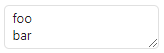

## NumberComponent

```ts
import { NumberComponent } from '@mnaoumov/obsidian-lib/setting-components/number-component';

const number = new NumberComponent(containerEl);
number.setValue(42);

// or

import { SettingEx } from '@mnaoumov/obsidian-lib/setting-ex';

new SettingEx(containerEl)
  .addNumber((number) => {
    number.setValue(42);
  });
```

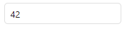

## PasswordComponent

```ts
import { PasswordComponent } from '@mnaoumov/obsidian-lib/setting-components/password-component';

const password = new PasswordComponent(containerEl);
password.setValue('alpha');

// or

import { SettingEx } from '@mnaoumov/obsidian-lib/setting-ex';

new SettingEx(containerEl)
  .addPassword((password) => {
    password.setValue('alpha');
  });
```

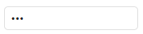

## TagListComponent

A [`ListComponent`](#listcomponent) of tags, stored without the `#` and shown with it. The new-item row suggests the vault's tags, most used first, whether or not the typed text starts with `#`, and a typed tag is refused unless it is a valid Obsidian tag: letters, digits, `_`, `-` and `/`, not digits only.

```ts
import { SettingEx } from '@mnaoumov/obsidian-lib/setting-ex';

new SettingEx(containerEl)
  .addTagList(app, (tagList) => {
    tagList.setValue(['project', 'area/health']);
  });
```

## TelephoneComponent

```ts
import { TelephoneComponent } from '@mnaoumov/obsidian-lib/setting-components/telephone-component';

const telephone = new TelephoneComponent(containerEl);
telephone.setValue('+123 456 78 90');

// or

import { SettingEx } from '@mnaoumov/obsidian-lib/setting-ex';

new SettingEx(containerEl)
  .addTelephone((telephone) => {
    telephone.setValue('+123 456 78 90');
  });
```

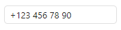

On mobile the keyboard for this component changes.

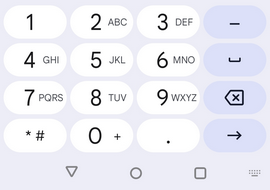

## TimeComponent

```ts
import { moment } from 'obsidian';
import { TimeComponent } from '@mnaoumov/obsidian-lib/setting-components/time-component';

const time = new TimeComponent(containerEl);
time.setValue(moment.duration({ hours: 12, minutes: 34 }));

// or

import { SettingEx } from '@mnaoumov/obsidian-lib/setting-ex';

new SettingEx(containerEl)
  .addTime((time) => {
    time.setValue(moment.duration({ hours: 12, minutes: 34 }));
  });
```

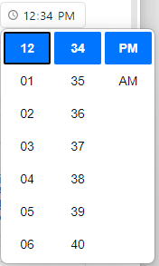

## TriStateCheckboxComponent

```ts
import { TriStateCheckboxComponent } from '@mnaoumov/obsidian-lib/setting-components/tri-state-checkbox-component';

const triStateCheckbox = new TriStateCheckboxComponent(containerEl);
triStateCheckbox.setValue(null);

// or

import { SettingEx } from '@mnaoumov/obsidian-lib/setting-ex';

new SettingEx(containerEl)
  .addTriStateCheckbox((triStateCheckbox) => {
    triStateCheckbox.setValue(null);
  });
```


## TypedDropdownComponent

```ts
import { TypedDropdownComponent } from '@mnaoumov/obsidian-lib/setting-components/typed-dropdown-component';

export class TypedItem {
  public static readonly Bravo = new TypedItem('Bravo');
  public static readonly Baz = new TypedItem('Baz');
  public static readonly Alpha = new TypedItem('Alpha');

  public constructor(public readonly name: string) {}
}

const typedDropdown = new TypedDropdownComponent(containerEl);
const map = new Map<TypedItem, string>();
map.set(TypedItem.Alpha, 'Display Alpha');
map.set(TypedItem.Bravo, 'Display Bravo');
map.set(TypedItem.Baz, 'Display Baz');
typedDropdown.addOptions(map);
typedDropdown.setValue(TypedItem.Bravo);

// or

import { SettingEx } from '@mnaoumov/obsidian-lib/setting-ex';

new SettingEx(containerEl)
  .addTypedDropdown((typedDropdown) => {
    const map = new Map<TypedItem, string>();
    map.set(TypedItem.Alpha, 'Display Alpha');
    map.set(TypedItem.Bravo, 'Display Bravo');
    map.set(TypedItem.Baz, 'Display Baz');
    typedDropdown.addOptions(map);
    typedDropdown.setValue(TypedItem.Bravo);
  });
```

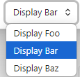

## TypedMultipleDropdownComponent

```ts
import { TypedMultipleDropdownComponent } from '@mnaoumov/obsidian-lib/setting-components/typed-multiple-dropdown-component';

export class TypedItem {
  public static readonly Bravo = new TypedItem('Bravo');
  public static readonly Baz = new TypedItem('Baz');
  public static readonly Alpha = new TypedItem('Alpha');

  public constructor(public readonly name: string) {}
}

const typedMultipleDropdown = new TypedMultipleDropdownComponent(containerEl);
const map = new Map<TypedItem, string>();
map.set(TypedItem.Alpha, 'Display Alpha');
map.set(TypedItem.Bravo, 'Display Bravo');
map.set(TypedItem.Baz, 'Display Baz');
typedMultipleDropdown.addOptions(map);
typedMultipleDropdown.setValue([TypedItem.Bravo, TypedItem.Baz]);

// or

import { SettingEx } from '@mnaoumov/obsidian-lib/setting-ex';

new SettingEx(containerEl)
  .addTypedMultipleDropdown((typedMultipleDropdown) => {
    const map = new Map<TypedItem, string>();
    map.set(TypedItem.Alpha, 'Display Alpha');
    map.set(TypedItem.Bravo, 'Display Bravo');
    map.set(TypedItem.Baz, 'Display Baz');
    typedMultipleDropdown.addOptions(map);
    typedMultipleDropdown.setValue([TypedItem.Bravo, TypedItem.Baz]);
  });
```

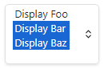

## UrlComponent

```ts
import { UrlComponent } from '@mnaoumov/obsidian-lib/setting-components/url-component';

const url = new UrlComponent(containerEl);
url.setValue('https://alpha.com/');

// or

import { SettingEx } from '@mnaoumov/obsidian-lib/setting-ex';

new SettingEx(containerEl)
  .addUrl((url) => {
    url.setValue('https://alpha.com/');
  });
```

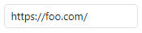

## WeekComponent

```ts
import { WeekComponent } from '@mnaoumov/obsidian-lib/setting-components/week-component';

const week = new WeekComponent(containerEl);
week.setValue({
  weekNumber: 6,
  year: 2025
});

// or

import { SettingEx } from '@mnaoumov/obsidian-lib/setting-ex';

new SettingEx(containerEl)
  .addWeek((week) => {
    week.setValue({
      weekNumber: 6,
      year: 2025
    });
  });
```

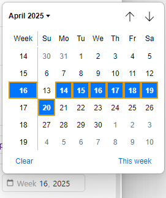

## Link and tag completion in any input

`LinkAndTagInputSuggest` adds the editor's `[[` and `#` completion to any `<input>` or `<textarea>`. Unlike Obsidian's `AbstractInputSuggest`, which treats the whole value as the query and replaces it, it reads the trigger before the caret and replaces only that, so it works inside free text such as a template or a description setting.

```ts
import { LinkAndTagInputSuggest } from '@mnaoumov/obsidian-lib/link-and-tag-input-suggest';
import { SettingEx } from '@mnaoumov/obsidian-lib/setting-ex';

new SettingEx(containerEl)
  .addTextArea((textArea) => {
    new LinkAndTagInputSuggest({ app, inputEl: textArea.inputEl });
  });
```

- `[[` suggests vault files, matched fuzzily on their link text or path, and inserts `[[link]]`, taking over a `]]` already after the caret. Links are relative to `sourcePath`, the vault root by default.
- `#` at the start of the text or after whitespace suggests the vault's tags, most used first, and inserts `#tag` and a space.
- `shouldSuggestLinks: false` or `shouldSuggestTags: false` turns one trigger off.
- The insertion dispatches an `input` event, so the text component's own `onChange` sees it. `onSelect` still reports the chosen suggestion.

## Settings tabs

`SettingsTabs` splits a settings tab into tabbed sections: a row of tab buttons and one panel, which renders only the selected tab and is emptied each time another is selected. The first tab added is selected, `selectTab` ignores an id it does not know (such as a stored id whose tab was since removed), and the arrow keys, Home and End move between tabs.

<!-- snippet-check: context declare let lastTabId: string | null; -->
```ts
import { Setting } from 'obsidian';
import { SettingsTabs } from '@mnaoumov/obsidian-lib/settings-tabs';

new SettingsTabs(containerEl)
  .addTab({
    id: 'general',
    name: 'General',
    render: (el) => {
      new Setting(el).setName('Name');
    }
  })
  .addTab({
    icon: 'wrench',
    id: 'advanced',
    name: 'Advanced',
    render: (el) => {
      new Setting(el).setName('Debug mode');
    }
  })
  .selectTab(lastTabId)
  .onTabChange((tabId) => {
    lastTabId = tabId;
  });
```

## Suggest popover at an anchor

`AnchoredSuggest` is Obsidian's suggest popover with no input behind it, for a picker opened from a button, a menu item or an editor decoration. `openAt` places it against an element or a viewport rectangle; arrows and Enter pick, and Escape, a pointer-down outside it, or its anchor element leaving the DOM close it. `setQuery` recomputes the suggestions in place.

```ts
import { AnchoredSuggest } from '@mnaoumov/obsidian-lib/anchored-suggest';

class ColorSuggest extends AnchoredSuggest<string> {
  public renderSuggestion(color: string, el: HTMLElement): void {
    el.setText(color);
  }

  protected getSuggestions(query: string): string[] {
    return ['red', 'green', 'blue'].filter((color) => color.includes(query));
  }

  protected onChooseSuggestion(color: string): void {
    console.log(color);
  }
}

const buttonEl = containerEl.createEl('button', { text: 'Pick a color' });
buttonEl.addEventListener('click', () => {
  void new ColorSuggest(app).openAt({ anchor: buttonEl });
});
```

## Editor suggests: opened from a command, or given priority

Obsidian asks each registered `EditorSuggest` in registration order and opens the first whose trigger accepts the text, so a plugin's suggest loses to Obsidian's own `[[` and `#` suggests, and to any plugin registered before it.

- `prioritizeEditorSuggest({ app, editorSuggest })` moves a registered suggest to the front of that list. `PluginEditorSuggestRegistrar.registerEditorSuggest(suggest, { shouldPrioritize: true })` does the same as it registers.
- `CommandEditorSuggest` is an `EditorSuggest` a command can open at the cursor, with no trigger character: `openFromCommand({ editor, file })` opens it, the text typed after that point on the same line is the query, and moving the cursor before it or off the line closes it. Override `onTextTrigger` to open it on typed text as well.

<!-- snippet-check: context declare const plugin: import('obsidian').Plugin; -->
```ts
import type { EditorSuggestContext } from 'obsidian';

import { CommandEditorSuggest } from '@mnaoumov/obsidian-lib/editor-suggest';

class EmojiSuggest extends CommandEditorSuggest<string> {
  public getSuggestions(context: EditorSuggestContext): string[] {
    return ['😀', '🎉', '🚀'].filter((emoji) => emoji.includes(context.query));
  }

  public renderSuggestion(emoji: string, el: HTMLElement): void {
    el.setText(emoji);
  }

  public selectSuggestion(emoji: string): void {
    this.context?.editor.replaceRange(emoji, this.context.start, this.context.end);
    this.close();
  }
}

const suggest = new EmojiSuggest(app);
plugin.registerEditorSuggest(suggest);
plugin.addCommand({
  editorCallback: (editor, ctx) => {
    suggest.openFromCommand({ editor, file: ctx.file });
  },
  id: 'insert-emoji',
  name: 'Insert emoji'
});
```

Both read Obsidian internals (`app.workspace.editorSuggest` and `EditorSuggest.trigger`), checked against Obsidian `1.15.0`.
