`@mnaoumov/obsidian-lib` provides some setting components that you can use in your plugin.

In order for components to look properly, their styles has to be initialized. See [Styling](/obsidian-lib/guides/styling/) for more details.

## CheckboxComponent

```ts
import { CheckboxComponent } from '@mnaoumov/obsidian-lib/settings/inputs/choices/checkbox-component';

const checkbox = new CheckboxComponent(containerEl);
checkbox.setValue(false);

// or

import { SettingEx } from '@mnaoumov/obsidian-lib/settings/setting-ex';

new SettingEx(containerEl)
  .addCheckbox((checkbox) => {
    checkbox.setValue(false);
  });
```


## CodeHighlighterComponent

```ts
import { CodeHighlighterComponent } from '@mnaoumov/obsidian-lib/settings/inputs/code-highlighter-component';

const codeHighlighter = new CodeHighlighterComponent(containerEl);
codeHighlighter
  .setLanguage('javascript')
  .setValue(`function alpha() {
  console.log('bravo');
}`);

// or

import { SettingEx } from '@mnaoumov/obsidian-lib/settings/setting-ex';

new SettingEx(containerEl)
  .addCodeHighlighter((codeHighlighter) => {
    codeHighlighter
      .setLanguage('javascript')
      .setValue(`function alpha() {
  console.log('bravo');
}`);
  });
```

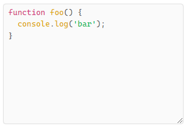

## DateComponent

```ts
import { DateComponent } from '@mnaoumov/obsidian-lib/settings/inputs/date-time/date-component';

const date = new DateComponent(containerEl);
date.setValue(new Date());

// or

import { SettingEx } from '@mnaoumov/obsidian-lib/settings/setting-ex';

new SettingEx(containerEl)
  .addDate((date) => {
    date.setValue(new Date());
  });
```

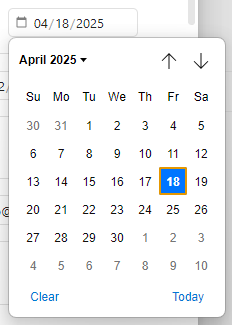

## DateTimeComponent

```ts
import { DateTimeComponent } from '@mnaoumov/obsidian-lib/settings/inputs/date-time/date-time-component';

const dateTime = new DateTimeComponent(containerEl);
dateTime.setValue(new Date());

// or

import { SettingEx } from '@mnaoumov/obsidian-lib/settings/setting-ex';

new SettingEx(containerEl)
  .addDateTime((dateTime) => {
    dateTime.setValue(new Date());
  });
```

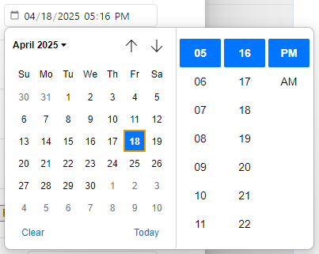

## EmailComponent

```ts
import { EmailComponent } from '@mnaoumov/obsidian-lib/settings/inputs/text/email-component';

const email = new EmailComponent(containerEl);
email.setValue('alpha@bravo.com');

// or

import { SettingEx } from '@mnaoumov/obsidian-lib/settings/setting-ex';

new SettingEx(containerEl)
  .addEmail((email) => {
    email.setValue('alpha@bravo.com');
  });
```

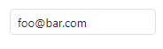

## FileComponent

```ts
import { FileComponent } from '@mnaoumov/obsidian-lib/settings/inputs/file-component';

const file = new FileComponent(containerEl);
file.onChange((value) => console.log(value));

// or

import { SettingEx } from '@mnaoumov/obsidian-lib/settings/setting-ex';

new SettingEx(containerEl)
  .addFile((file) => {
    file.onChange((value) => console.log(value));
  });
```

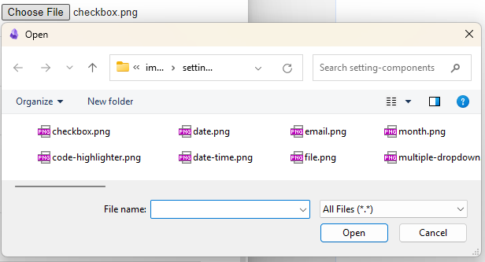

## MonthComponent

```ts
import { MonthComponent } from '@mnaoumov/obsidian-lib/settings/inputs/date-time/month-component';

const month = new MonthComponent(containerEl);
month.setValue({
  month: 4,
  year: 2025
});

// or

import { SettingEx } from '@mnaoumov/obsidian-lib/settings/setting-ex';

new SettingEx(containerEl)
  .addMonth((month) => {
    month.setValue({
      month: 4,
      year: 2025
    });
  });
```

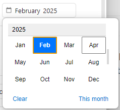

## MultipleDropdownComponent

```ts
import { MultipleDropdownComponent } from '@mnaoumov/obsidian-lib/settings/inputs/multiple/multiple-dropdown-component';

const multipleDropdown = new MultipleDropdownComponent(containerEl);
multipleDropdown.addOptions({
  Value1: 'Display 1',
  Value2: 'Display 2',
  Value3: 'Display 3',
  Value4: 'Display 4',
  Value5: 'Display 5'
});
multipleDropdown.setValue(['Value2', 'Value3']);

// or

import { SettingEx } from '@mnaoumov/obsidian-lib/settings/setting-ex';

new SettingEx(containerEl)
  .addMultipleDropdown((multipleDropdown) => {
    multipleDropdown.addOptions({
      Value1: 'Display 1',
      Value2: 'Display 2',
      Value3: 'Display 3',
      Value4: 'Display 4',
      Value5: 'Display 5'
    });
    multipleDropdown.setValue(['Value2', 'Value3']);
  });
```

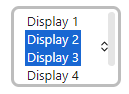

## MultipleEmailComponent

```ts
import { MultipleEmailComponent } from '@mnaoumov/obsidian-lib/settings/inputs/multiple/multiple-email-component';

const multipleEmail = new MultipleEmailComponent(containerEl);
multipleEmail.setValue(['alpha@bravo.com', 'charlie@delta.com']);

// or

import { SettingEx } from '@mnaoumov/obsidian-lib/settings/setting-ex';

new SettingEx(containerEl)
  .addMultipleEmail((multipleEmail) => {
    multipleEmail.setValue(['alpha@bravo.com', 'charlie@delta.com']);
  });
```

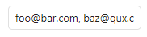

## MultipleFileComponent

```ts
import { MultipleFileComponent } from '@mnaoumov/obsidian-lib/settings/inputs/multiple/multiple-file-component';

const multipleFile = new MultipleFileComponent(containerEl);
multipleFile.onChange((value) => console.log(value));

// or

import { SettingEx } from '@mnaoumov/obsidian-lib/settings/setting-ex';

new SettingEx(containerEl)
  .addMultipleFile((multipleFile) => {
    multipleFile.onChange((value) => console.log(value));
  });
```

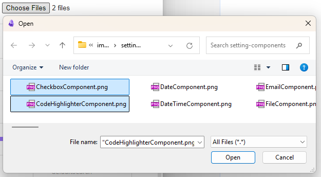

## MultipleTextComponent

```ts
import { MultipleTextComponent } from '@mnaoumov/obsidian-lib/settings/inputs/multiple/multiple-text-component';

const multipleText = new MultipleTextComponent(containerEl);
multipleText.setValue(['alpha', 'bravo']);

// or

import { SettingEx } from '@mnaoumov/obsidian-lib/settings/setting-ex';

new SettingEx(containerEl)
  .addMultipleText((multipleText) => {
    multipleText.setValue(['alpha', 'bravo']);
  });
```

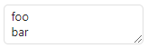

## NumberComponent

```ts
import { NumberComponent } from '@mnaoumov/obsidian-lib/settings/inputs/number-component';

const number = new NumberComponent(containerEl);
number.setValue(42);

// or

import { SettingEx } from '@mnaoumov/obsidian-lib/settings/setting-ex';

new SettingEx(containerEl)
  .addNumber((number) => {
    number.setValue(42);
  });
```

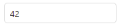

## PasswordComponent

```ts
import { PasswordComponent } from '@mnaoumov/obsidian-lib/settings/inputs/text/password-component';

const password = new PasswordComponent(containerEl);
password.setValue('alpha');

// or

import { SettingEx } from '@mnaoumov/obsidian-lib/settings/setting-ex';

new SettingEx(containerEl)
  .addPassword((password) => {
    password.setValue('alpha');
  });
```

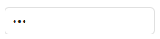

## TelephoneComponent

```ts
import { TelephoneComponent } from '@mnaoumov/obsidian-lib/settings/inputs/text/telephone-component';

const telephone = new TelephoneComponent(containerEl);
telephone.setValue('+123 456 78 90');

// or

import { SettingEx } from '@mnaoumov/obsidian-lib/settings/setting-ex';

new SettingEx(containerEl)
  .addTelephone((telephone) => {
    telephone.setValue('+123 456 78 90');
  });
```

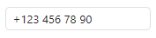

On mobile the keyboard for this component changes.

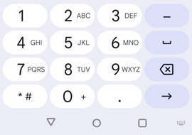

## TimeComponent

```ts
import { moment } from 'obsidian';
import { TimeComponent } from '@mnaoumov/obsidian-lib/settings/inputs/date-time/time-component';

const time = new TimeComponent(containerEl);
time.setValue(moment.duration({ hours: 12, minutes: 34 }));

// or

import { SettingEx } from '@mnaoumov/obsidian-lib/settings/setting-ex';

new SettingEx(containerEl)
  .addTime((time) => {
    time.setValue(moment.duration({ hours: 12, minutes: 34 }));
  });
```

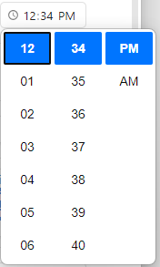

## TriStateCheckboxComponent

```ts
import { TriStateCheckboxComponent } from '@mnaoumov/obsidian-lib/settings/inputs/choices/tri-state-checkbox-component';

const triStateCheckbox = new TriStateCheckboxComponent(containerEl);
triStateCheckbox.setValue(null);

// or

import { SettingEx } from '@mnaoumov/obsidian-lib/settings/setting-ex';

new SettingEx(containerEl)
  .addTriStateCheckbox((triStateCheckbox) => {
    triStateCheckbox.setValue(null);
  });
```


## TypedDropdownComponent

```ts
import { TypedDropdownComponent } from '@mnaoumov/obsidian-lib/settings/inputs/choices/typed-dropdown-component';

export class TypedItem {
  public static readonly Bravo = new TypedItem('Bravo');
  public static readonly Baz = new TypedItem('Baz');
  public static readonly Alpha = new TypedItem('Alpha');

  public constructor(public readonly name: string) {}
}

const typedDropdown = new TypedDropdownComponent(containerEl);
const map = new Map<TypedItem, string>();
map.set(TypedItem.Alpha, 'Display Alpha');
map.set(TypedItem.Bravo, 'Display Bravo');
map.set(TypedItem.Baz, 'Display Baz');
typedDropdown.addOptions(map);
typedDropdown.setValue(TypedItem.Bravo);

// or

import { SettingEx } from '@mnaoumov/obsidian-lib/settings/setting-ex';

new SettingEx(containerEl)
  .addTypedDropdown((typedDropdown) => {
    const map = new Map<TypedItem, string>();
    map.set(TypedItem.Alpha, 'Display Alpha');
    map.set(TypedItem.Bravo, 'Display Bravo');
    map.set(TypedItem.Baz, 'Display Baz');
    typedDropdown.addOptions(map);
    typedDropdown.setValue(TypedItem.Bravo);
  });
```

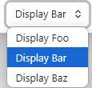

## TypedMultipleDropdownComponent

```ts
import { TypedMultipleDropdownComponent } from '@mnaoumov/obsidian-lib/settings/inputs/choices/typed-multiple-dropdown-component';

export class TypedItem {
  public static readonly Bravo = new TypedItem('Bravo');
  public static readonly Baz = new TypedItem('Baz');
  public static readonly Alpha = new TypedItem('Alpha');

  public constructor(public readonly name: string) {}
}

const typedMultipleDropdown = new TypedMultipleDropdownComponent(containerEl);
const map = new Map<TypedItem, string>();
map.set(TypedItem.Alpha, 'Display Alpha');
map.set(TypedItem.Bravo, 'Display Bravo');
map.set(TypedItem.Baz, 'Display Baz');
typedMultipleDropdown.addOptions(map);
typedMultipleDropdown.setValue([TypedItem.Bravo, TypedItem.Baz]);

// or

import { SettingEx } from '@mnaoumov/obsidian-lib/settings/setting-ex';

new SettingEx(containerEl)
  .addTypedMultipleDropdown((typedMultipleDropdown) => {
    const map = new Map<TypedItem, string>();
    map.set(TypedItem.Alpha, 'Display Alpha');
    map.set(TypedItem.Bravo, 'Display Bravo');
    map.set(TypedItem.Baz, 'Display Baz');
    typedMultipleDropdown.addOptions(map);
    typedMultipleDropdown.setValue([TypedItem.Bravo, TypedItem.Baz]);
  });
```

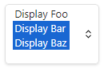

## UrlComponent

```ts
import { UrlComponent } from '@mnaoumov/obsidian-lib/settings/inputs/text/url-component';

const url = new UrlComponent(containerEl);
url.setValue('https://alpha.com/');

// or

import { SettingEx } from '@mnaoumov/obsidian-lib/settings/setting-ex';

new SettingEx(containerEl)
  .addUrl((url) => {
    url.setValue('https://alpha.com/');
  });
```

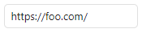

## WeekComponent

```ts
import { WeekComponent } from '@mnaoumov/obsidian-lib/settings/inputs/date-time/week-component';

const week = new WeekComponent(containerEl);
week.setValue({
  weekNumber: 6,
  year: 2025
});

// or

import { SettingEx } from '@mnaoumov/obsidian-lib/settings/setting-ex';

new SettingEx(containerEl)
  .addWeek((week) => {
    week.setValue({
      weekNumber: 6,
      year: 2025
    });
  });
```

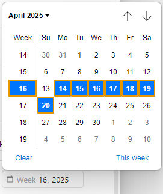
